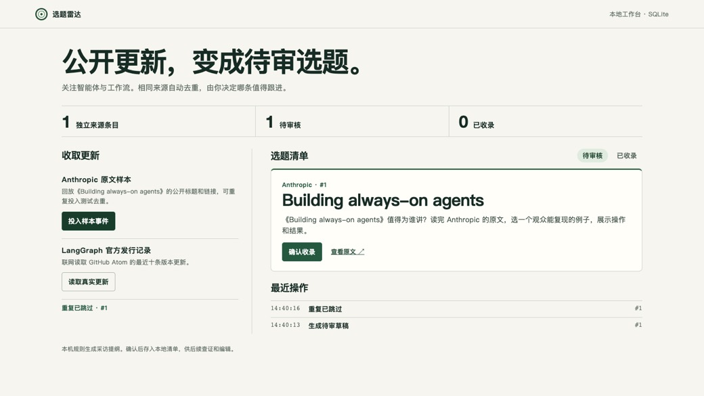

# 常驻智能体中文实战指南

一条产品更新来了，助手该不该打扰你？同一条消息送来两次，会不会多写一份？关掉进程，明早还能不能找到等你批准的草稿？这个仓库用一个**选题雷达**把三个问题做成可以亲手检查的实验。



| 你现在想做的事 | 从这里开始 |
| --- | --- |
| 直接让现有助手每天交一份有出处的简报 | [复制零代码任务，按界面步骤设置](docs/零代码做一份选题简报.md) |
| 不买 API，亲手试一次收件、去重、重启和审批 | [五分钟运行本地雷达](docs/五分钟上手.md) |
| 让本机模型给一条公开更新写一个可拍的选题 | [把真实模型接进草稿环节](docs/接本机模型.md) |
| 决定该用 Claude、DeepSeek 还是 LangChain | [按场景选型与一手资料](docs/选型与一手资料.md) |

## 先看它怎样工作

```text
公开来源 → 收件并按原文链接去重 → 把进度写入数据库 → 待审草稿 → 人工确认
                                           ↓
                                   重启后仍可找回
```

有事才唤醒的系统可以长期待命。模型只需要在值得判断的环节出场。仓库的默认示例把筛选规则写明，方便你断开网络也能复现；可选的本机模型负责另拟角度，能联网的任务可以再接入公开更新源。数据库记录每条更新处在哪一步。审批后的结果仍在本地，适合先检验再决定是否对外发布。

## 三个验收问题

- **同一条消息再投一次呢？** 比较前后的事件数与草稿数。上游重试很常见，一次事件只应该产生一次业务结果。
- **等你批准时关掉程序呢？** 用同一个数据库重新打开，找刚才那条待审稿。聊天历史很长，并不能证明应用保存了任务状态。
- **读不到原文呢？** 在交给模型的资料里标出缺失，要求把推测写成待验证问题。最后由人点开原链接抽查。

## 为什么一起看这几家

Anthropic 解释长期运行要保存什么，DeepSeek 的公开原型展示谁接件、谁干活，LangChain 展示如何让主对话在后台任务进行时继续响应。三篇放在一起，正好覆盖同一个助手的三个设计决定。11 月下旬的 MCP Tasks 又把长工作交给工具服务器，适合已有连接器的团队。资料核对至 **2026-11-27**。[Anthropic 架构指南](https://claude.com/resources/articles/building-always-on-agents) · [DeepSeek 原型](https://github.com/deepseek-ai/dsh-superagent-prototype) · [LangChain 异步设计](https://www.langchain.com/blog/agents-are-going-async) · [MCP Tasks 实际接入](https://claude.com/resources/articles/skills-over-mcp-tasks-and-more)

这份中文实战受 Xudong Han 对三条路线的对照启发。仓库中的演示和任务模板为这期视频编写，官方图示、视频和完整原文请在各自来源查看。[选题缘起](https://x.com/Xudong07452910/status/2121775188639437102)
